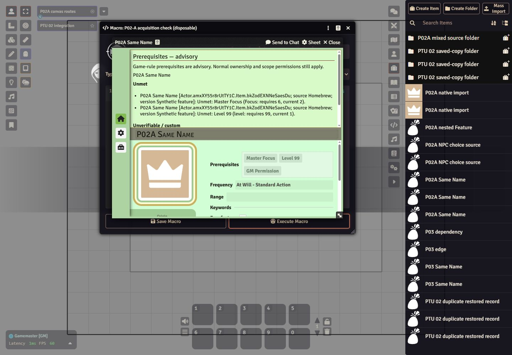
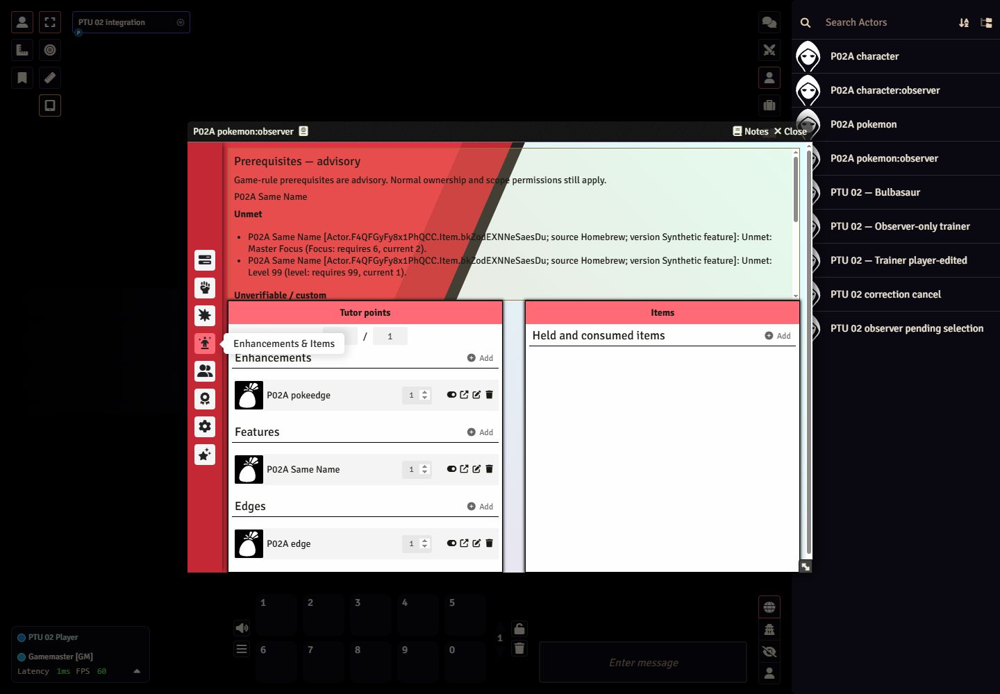

# P02-A acquisition and display — 2026-10-26

Historical observations within this matrix; **pending substantive planner acceptance**. Accepted predecessors are P03 `c547e3ac86855e61c52ecd7816fdd23ac17c1c2c` and P02-P `d7dc7f0b4002110f0e44ab09decaebf5ec5bcf38`. Earlier tested runtime/build is `077711dbb4c928180483505282b094c8c94eecf0`, on `codex/ptu-foundation`, existing draft [PR #4](https://github.com/MrMints/ptu_1.05/pull/4). At its original evidence revision, follow-up files were diagnostic/evidence/documentation only. Later correction runtime and its artifact supersede affected claims. Final pushed-head CI is recorded in the handoff.

**Correction notice:** review reproduced mixed-batch Condition writes on cancellation and saved-grant replay not covered by the original passing cases. The [P02-A correction](2026-10-26-p02a-correction.md) records failures, fixes, actual source-aware Document copy/drop, final artifact, player and reload evidence at `416c645e`. Earlier observations remain valid only within their tested limits; general cancellation/no-replay/complete-restoration claims below are superseded. P02-A is still pending substantive acceptance.

The [machine evidence](2026-10-26-p02a.json) retains exact identities, raw prerequisites/version context, before/after numeric values, failed observations, corrected executions, file hashes and reload expectations. The [16-route inventory](../data/p02a-routes.json) classifies entrypoints and predicates. This gate does not implement production original/errata alternatives or approve inherited content.

## Implementation

- Trainer and Pokémon accept `feat`, `edge` and `pokeedge`. Both actor sheets and all three Item sheets show escaped itemized unmet and unverifiable/custom reports, derived from the actual owned raw requirements and saved selected-version context. No report flags are saved. Ordinary owner/scope checks remain.
- Trainer Features/Edges includes Poké Edges; Pokémon Enhancements & Items includes Features and Edges alongside its existing Enhancements (`pokeedge`) collection. No fictional cross-actor budget is added. Name/translation changes cannot select a different record or class group.
- Explicit NPC selection retains ranks and selections. Generation stages real nested choices before creating folders/actors; cancellation writes neither. Ordinary actor-creation permission applies. Starting Training remains a pending one-time entitlement for generated trainers rather than a competing automatic prompt.
- Owned creation checks permission before rules run, clones caller sources, supplies normal minimal-data defaults and stages actual grants/choices once. The original saved inline/copy cases passed their specific assertions; later mixed/saved-graph failures and their correction are recorded above. Feature/Edge drops do not use inventory quantity merging. Deliberate class grouping uses exact owned IDs; class labels do not recreate or overwrite saved relationships.
- New compendium grants stamp the exact acquired canonical provenance, including legacy UUID syntax; saved/world copies retain their underlying provenance. Legitimate repeat additions remain possible.
- Blank/empty/unsupported selected-version values remain unchanged but produce `rule-version-unestablished`. This does not turn satisfied prerequisites into unmet ones or establish an approved edition.
- Canvas drops use v13 token bounds instead of a possibly null hit area. Actor and embedded dependency changes refresh already-open owned Item reports, including Pokémon species skill changes.

The complete source inventory contains 205 conditional rules: 136 ChoiceSets and 69 grants. There are no top-level ChoiceSet predicates and no resolved conditional grant to a Feature/Edge/Poké Edge. Resolved grants target 62 Abilities, three Moves, two capabilities and one condition; one dynamic target remains unresolved authoring context (`effects.yeB0636J5xIOKKIW`, `/system/rules/1`). Genuine choice-member and conditional-effect predicates remain. This is an operational classification, not source/rules approval or permission to disable an unresolved predicate.

## Validation

**43/43 focused** and **120/120 full local tests pass**. The focused command is `node --test --test-isolation=none tests/acquisition.test.mjs tests/prerequisites.test.mjs tests/preservation.test.mjs tests/starter-training.test.mjs`; the full command is `node --test --test-isolation=none tests/*.test.mjs`. Tests execute actual production class bodies with controlled Foundry IO, plus the normal evaluator modules. They cover minimal creation, staging/cancellation, permissions before side effects, cross-actor collections, exact grouping, attribution shapes, read-only rendering, v13 canvas geometry and dependent report refresh. Source validation passes for 17 skill interfaces, 15 packs and 7,395 original source records. Unchanged pack/compiler semantic evidence is reused locally; normal CI repeats it.

Fresh final archive: **1,108,948,426 bytes**, 6,841 entries, SHA-256 `09854eb5758450780331e5a167c598c67e6f85654e1be892e7dbca638e9a74ce`. All **3,502 src/static files** match checkout, ZIP and installation exactly. Installation ran with the server stopped and the data-directory lock held, preserved Config/world bytes, and retained a recoverable backup. PDFs, source JSON, test tools and world data are excluded. Foundry is **13.351**, PTU software **4.4.3**, world **`ptu-verification`**. This remains a development candidate, not a supported release.

## Actual Foundry matrix

| Family | Expected and observed result | Evidence run(s) |
| --- | --- | --- |
| Sheet new/drop; browser entry; native compendium import/drop; direct embedded creation; world/owned copy; mixed folder; supported JSON restoration; Item duplication; repeat add | Both actor types receive real Items and their own raw/version reports. Relevant ranks/stats/level/health/money stay exact. Fresh actors and execution IDs are used; no cached pass markers authorize a skip. | `routes-final` has 23 passes and two retained folder failures; `mixed-folder-final` supplies two fresh passing replacements. Together, with inline/actor duplication/NPC below, all 25 required scenarios have passing final-runtime executions. Unselected rerun rows remain **not-run**. |
| Inline actor Items; actor duplication | Three advisory Item types and their diagnostics persist; existing populated actors are not retrofitted with starter Training. These cases assert their explicit type/report/entitlement checks, not a general actor-creation numeric equivalence. | `routes-final` |
| Explicit NPC refresh/generation | Only the selected Feature and Edge remain; Focus stays rank 2; two owned diagnostics exist; the starter entitlement remains pending. | `routes-final` |
| Linked/unlinked token drop | All four actual canvas hook → token → sheet routes add a real Feature with a report and unchanged numeric state. Repeated actual use also passes. | `canvas-corrected`, `canvas-final`; final output is versioned |
| Nested grant/real choice | Trainer and Pokémon select a Feature that grants a Poké Edge. Both have advisory reports; no incidental numeric change. Actual UI cancellation preserves the complete actor snapshot. | `character-select-final`, `pokemon-select-final`, both `cancel-final` |
| NPC choice cancellation; conditional effects | Actual UI cancellation leaves actor/folder counts exact. False conditional GrantItem predicates grant no dependency; the wrapper alone persists. | `npc-cancel-final`, both `conditions-final` |
| Starting Training | Actual initial choice completes once; final runtime refuses a repeat; saved/reloaded status and selected Item persist. Initial selection at `02a24aac` reuses unchanged starter/staging behavior; final runtime repeats denial and persistence. | `starter-first`, `starter-check-final`, reload |
| Real player/ordinary security | 37/37: nine owner add/copy/grant paths and nine observer attempts on each actor type, plus normal role denial of NPC generation. Owners receive Items/reports without numeric changes; observer actor hashes stay exact. No fake GM/user substitution is used. | `player-final`, `permissions-final` |
| Manual owner/observer UI | Both actor collections and reports are visible. Observer form fields are disabled and Add anchors are inert. A real player Add creates a trainer Poké Edge. Observer hashes remain exact after these UI actions. | `ui-final`, captured UI text/screenshots |
| Truth/version/name changes | Empty objects, blank strings, arrays, scalars, unrelated objects and null remain raw and unverifiable; meaningful explicit strings/id/label objects pass attribution shape without changing prerequisite truth. Same-name synthetic versions retain different raw/required skill reports after renaming, including literal HTML-like text. | `shape-final`; `identity-corrected-final` at `c04c8ae2`, unchanged evaluator/acquisition/source/grant blobs at final runtime |
| Recompute/open Item UI | Rank and raw-prerequisite edits recompute on both actors. Pokémon uses the actual owned species skill input. A species-only 2→6→2 edit updates the already-open Feature report in both directions. | `recompute-final`, `rank-ui-final-six`, `rank-ui-final-two`, captured actual UI text |
| Scope and preservation | Three exact accepted exclusions are refused before their behavior executes. Conservative real pack refresh twice preserves existing fields/flags; injected migration failure preserves the actual Document, then retry recovers without changing the world stamp. | `scope-final`, `preserve-final`; unchanged broader P02-P evidence remains accepted |
| Harness negative/positive | A deliberate money 0→1 change on a newly created task actor fails. A different fresh actor with 0→0 passes. The actual Item creation/evaluator code is unchanged at final runtime; its later actor hook adds rendering only. | `harness-negative`, `harness-positive` at `c04c8ae2` |
| Actual client reload | All **86 task actors**, their embedded Items and derived reports match pre-reload hashes. All **16 pre-existing actors**, **10 pre-existing world Items** and world schema 0.115 remain exact. | `checkpoint-final`, first two passing `reload-first` scenarios |
| Unlinked persistence | The first reload preserves exact scene/token sources and every recorded acquired Item/version/prerequisite/report, but two unlinked actors inherit later base-actor additions. Every extra identity/raw/version matches its exact base Item. A second read-only checkpoint/reload with stable bases preserves the full scene, all four existing token UUIDs, linked/synthetic actor sources and reports. No Item is added between that checkpoint and reload. | Retained failure in `reload-first`; `tokenInheritanceAudit`, `token-stable-checkpoint`, `token-reload-final` |

The live diagnostic calls the real creation/drop/import/generator/rule APIs inside Foundry through saved GM/player Script macros. Sheet navigation, launch/join, choices/cancellation, player Add/read-only actions and reload are UI driven. This does not claim that every route was performed by a literal mouse drag or every core context menu was clicked.

## Failures retained and dispositions

Initial first-run routes were 19 pass / six fail; browser UUID assertion and native-import pack argument were harness errors. Minimal owned Item creation exposed a real missing-system-object crash, now fixed. Canvas timed out twice because real v13 token hit areas were null; the bounds fix passes actual four-token use.

The next JSON attempt exposed a core v13 API limitation: embedded `Item.importFromJSON` calls `collection.fromCompendium`, which an embedded collection does not provide. The supported world Item JSON restoration → owned copy route passes. No core embedded-import repair is claimed.

The shape fixture initially merged `{}` recursively with the old flag. Corrected cases unset then set the requested raw value, record requested/stored values and both diagnostics before asserting, and restore inputs in `finally`. The initial preservation test lacked a successful real pack acquisition; the corrected fixture uses an actual acquired exact pack Item. Identity assertions initially assumed Novice Charm was satisfied at rank 2 and ignored the trainer's derived level 1; corrected assertions verify the exact required/current skill and each version's raw array. Folder reuse later accumulated legitimate JSON-restored Items; a fresh three-type source folder and fresh actor pass on each affected route. None of those harness corrections changed prerequisite truth or ignored a failed required case.

Recompute initially wrote the trainer-style raw rank on Pokémon, whose effective rank comes from species data. Using the actual species input exposed the real stale open-Item UI, fixed by embedded-dependency refresh hooks. Final 2→6→2 UI observations and an actual-class regression cover it. The first unlinked reload mismatch is retained and explained above; a whole unlinked actor is not claimed independent of later base-actor edits.

## Reproduce and limits

Serve `tools/foundry-p02a-check.mjs` in `.foundry-test/Data/ptu02-acquisition/check.mjs`, with `plan.json` selecting a documented phase and tested runtime. The saved GM macro imports it with a cache-busting query and calls `runP02ACheck()`. Use `init` only once before creating fixtures: it captures protected pre-existing data. Route reruns always create fresh actors; selected reruns explicitly emit not-run for other rows. Choice phases require real UI selection/close. `permissions` prepares only disposable ownership fixtures and a player-readable macro calling `runP02APlayerCheck()`; it does not change roles or account permissions.

Capture `checkpoint.persisted` as `expected.json` and `scenePersisted` as `expected-tokens.json` before actual reload. Keep original expectations and failures. The token-only stable rerun uses the same four UUIDs and requires nonempty acquired Item lists. It must not create another Item to substitute for persistence proof. Raw reports, histories and hashes are in the versioned JSON; temporary helper files/logs and full local screen captures remain ignored.

Synthetic version labels do not establish approved original/errata pairs. Full selectors, effective-rule lookup, replacement/nonstacking and future migrations remain 05. No general Move/rule/automation correctness, arbitrary campaign upgrades, whole-world transactional rollback, multi-client contention or broad layout certification is claimed. Existing source packs and their 7,395 records are unchanged; inventory is not supported scope. Full excluded/unclassified release separation remains staged work. No Generation 9 behavior was exercised; guards are the accepted three exact identities only. Prior V1/manifest/update-URL warnings remain.

The world was observed at Setup before stopping the owned server. The terminal is complete, port 30001 refuses connections, the inactive lock was reclaimed/released through Foundry's lock library, and the temporary viewport was reset. No final graceful-process log line was captured. Disposable fixtures, diagnostics and recoverable installation backups remain. Ownership is released only by the final successful CI handoff. **Stop for substantive P02-A acceptance; P01, remaining P04/D and 05 are not started.**
